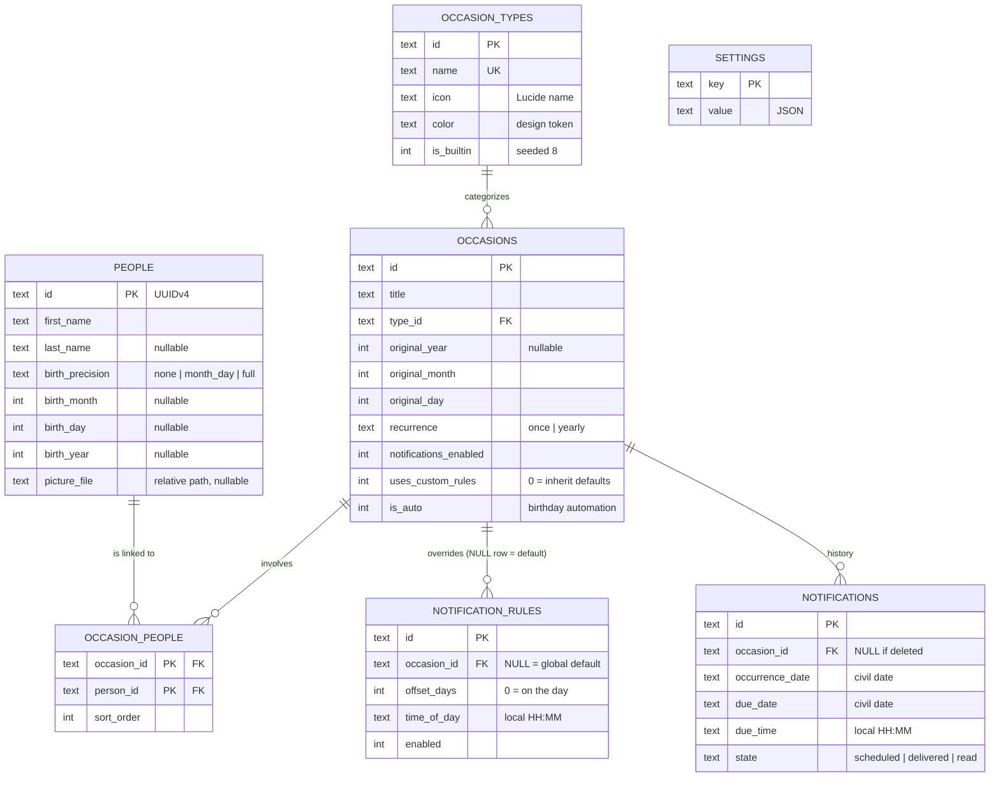

# Keepsake — Data Model

**Status:** v0.2 (Phase 0)
**Related:** `product-rules.md` (rules referenced as R#), `nasty-dates.md`

## 1. Conventions

- Single SQLite database file in the OS app-data directory.
  Connections: foreign keys **ON**, WAL journal mode.
- **Primary keys** are UUIDv4 strings generated in Rust.
  *Why:* JSON export/import and merge (Phase 8) then works without ID remapping.
- Booleans are `INTEGER` 0/1.
- **Civil dates** (occasion/birth dates, due dates) are stored as components:
  `*_month INTEGER` (1–12), `*_day INTEGER` (1–31), `*_year INTEGER NULL`.
  A missing year is always NULL — never a placeholder (R4).
- **Clock times** are `TEXT` local wall clock, `'HH:MM'`.
- **Metadata instants** (`created_at`, `delivered_at`, …) are `TEXT` ISO 8601 UTC
  (`2025-01-31T21:04:00Z`). Bookkeeping only (R3).
- Month/day validity (including Feb 29 in leap years) is validated in **Rust**,
  not by SQL CHECK — see invariants §5.
- Migrations are numbered and **append-only**; `schema_migrations` records what
  has run. An applied migration is never edited.

## 2. Entities

### 2.1 `people`

| Column | Type | Constraints | Notes |
| --- | --- | --- | --- |
| `id` | TEXT | PK | UUIDv4 |
| `first_name` | TEXT | NOT NULL | |
| `last_name` | TEXT | | Optional |
| `relationship_label` | TEXT | | Free text; UI suggests `family`, `friend`, `colleague`; normalized (trim, case) on input |
| `birth_precision` | TEXT | NOT NULL DEFAULT `'none'`, CHECK `IN ('none','month_day','full')` | Implements R4 |
| `birth_month` | INTEGER | CHECK `1–12` | NULL unless `month_day`/`full` |
| `birth_day` | INTEGER | CHECK `1–31` | NULL unless `month_day`/`full` |
| `birth_year` | INTEGER | | Present only when `full` |
| `notes` | TEXT | | |
| `picture_file` | TEXT | | **Relative** path under app-data dir, e.g. `pictures/3f9c….jpg`; never absolute (breaks if folder moves) |
| `created_at` | TEXT | NOT NULL | UTC instant |
| `updated_at` | TEXT | NOT NULL | UTC instant |

**Consistency CHECK (SQL):**
`full` → year, month, day all present · `month_day` → month + day present, year
NULL · `none` → all three NULL.

### 2.2 `occasion_types`

| Column | Type | Constraints | Notes |
| --- | --- | --- | --- |
| `id` | TEXT | PK | |
| `name` | TEXT | NOT NULL, UNIQUE | |
| `icon` | TEXT | NOT NULL | Lucide icon name (e.g. `cake`, `heart`) |
| `color` | TEXT | NOT NULL | Design **token** name (`terracotta`, `sage`, …), never raw hex |
| `is_builtin` | INTEGER | NOT NULL DEFAULT 0 | |
| `sort_order` | INTEGER | NOT NULL DEFAULT 0 | |

Migration 001 seeds the 8 built-ins: birthday, wedding anniversary,
relationship anniversary, wedding, memorial day, graduation anniversary,
personal milestone, general event. Built-ins are never deleted; custom types
(`is_builtin = 0`) may be deleted only when unused (FK is RESTRICT).

### 2.3 `occasions`

| Column | Type | Constraints | Notes |
| --- | --- | --- | --- |
| `id` | TEXT | PK | |
| `title` | TEXT | NOT NULL | Auto birthdays: generated from the person's name, regenerated on rename |
| `type_id` | TEXT | NOT NULL, FK → `occasion_types(id)` ON DELETE RESTRICT | |
| `original_year` | INTEGER | | NULL when year unknown (yearly occasions only) |
| `original_month` | INTEGER | NOT NULL, CHECK `1–12` | |
| `original_day` | INTEGER | NOT NULL, CHECK `1–31` | Feb 29 with year NULL is legal only for `yearly` |
| `recurrence` | TEXT | NOT NULL DEFAULT `'yearly'`, CHECK `IN ('once','yearly')` | |
| `notifications_enabled` | INTEGER | NOT NULL DEFAULT 1 | Occasion-level master switch (R17) |
| `uses_custom_rules` | INTEGER | NOT NULL DEFAULT 0 | 1 = occasion has its own rule set; 0 = inherits global defaults (R17) |
| `description` | TEXT | | |
| `location` | TEXT | | |
| `is_auto` | INTEGER | NOT NULL DEFAULT 0 | 1 = system-maintained from a person's birth date (R11) |
| `created_at` | TEXT | NOT NULL | |
| `updated_at` | TEXT | NOT NULL | |

**CHECK:** `recurrence = 'once'` → `original_year` NOT NULL (R8).

**Deliberate omission:** there is no "next occurrence" column. It is always
computed (R9). Storing it would create a second source of truth.

### 2.4 `occasion_people` — many-to-many link

| Column | Type | Constraints | Notes |
| --- | --- | --- | --- |
| `occasion_id` | TEXT | PK(part), FK → `occasions(id)` ON DELETE CASCADE | |
| `person_id` | TEXT | PK(part), FK → `people(id)` ON DELETE CASCADE | |
| `sort_order` | INTEGER | NOT NULL DEFAULT 0 | Display order for two-person occasions |

Primary key `(occasion_id, person_id)`. Cardinality rules (R12) are enforced in
app validation, not SQL.

### 2.5 `notification_rules`

| Column | Type | Constraints | Notes |
| --- | --- | --- | --- |
| `id` | TEXT | PK | |
| `occasion_id` | TEXT | NULL, FK → `occasions(id)` ON DELETE CASCADE | **NULL = global default rule**; non-NULL = per-occasion override |
| `offset_days` | INTEGER | NOT NULL, CHECK `≥ 0` | Days **before** the occasion; `0` = on the day |
| `time_of_day` | TEXT | NOT NULL DEFAULT `'09:00'` | Local wall clock (R19) |
| `enabled` | INTEGER | NOT NULL DEFAULT 1 | Per-rule disable |

**Uniqueness** (two partial indexes, because SQL UNIQUE treats NULLs as distinct):
- `(occasion_id, offset_days, time_of_day)` WHERE `occasion_id IS NOT NULL`
- `(offset_days, time_of_day)` WHERE `occasion_id IS NULL`

An occasion applies its own rows only while `occasions.uses_custom_rules = 1`;
while it is 0, the occasion inherits the global defaults. The editor
materializes the effective rules as occasion rows on first customization (R17).
Rust rejects any rule row attached to an occasion whose flag is 0.

### 2.6 `notifications` — history and scheduling state

| Column | Type | Constraints | Notes |
| --- | --- | --- | --- |
| `id` | TEXT | PK | |
| `occasion_id` | TEXT | NULL, FK → `occasions(id)` ON DELETE **SET NULL** | NULL = occasion deleted; history survives |
| `occasion_title` | TEXT | NOT NULL | Snapshot when scheduled |
| `occurrence_date` | TEXT | NOT NULL | Civil `YYYY-MM-DD` of the occasion instance this row belongs to |
| `offset_days` | INTEGER | NOT NULL | Snapshot of the rule |
| `due_date` | TEXT | NOT NULL | Civil date = `occurrence_date − offset_days` |
| `due_time` | TEXT | NOT NULL | Local `'HH:MM'` |
| `state` | TEXT | NOT NULL DEFAULT `'scheduled'`, CHECK `IN ('scheduled','delivered','read')` | Lifecycle: scheduled → delivered → read |
| `delivered_at` | TEXT | | UTC instant actually delivered |
| `read_at` | TEXT | | UTC instant marked read |
| `created_at` | TEXT | NOT NULL | |

**Dedupe (R18):** `UNIQUE (occasion_id, occurrence_date, offset_days)` — one row
per occasion + occurrence + rule, ever. Stale `scheduled` rows are deleted when
an occasion is edited or deleted; delivered rows remain (snapshots keep them
renderable without the occasion).

**Pending rows are a rolling window.** The scheduler materializes `scheduled`
rows for upcoming occurrence(s) only and regenerates them as time advances;
rows whose due moment passed while the app was closed become R20's "missed"
inputs. Changing a rule's time updates the matching pending row in place —
the dedupe key omits `time_of_day` deliberately. Dedupe applies while
`occasion_id` is set; after SET NULL the row is pure history and duplicates
are harmless.

### 2.7 `settings`

| Column | Type | Constraints |
| --- | --- | --- |
| `key` | TEXT | PK |
| `value` | TEXT | NOT NULL — JSON-encoded scalar or object |

Known keys (v1): `theme` (`system|light|dark`), `first_day_of_week`
(`monday|sunday`), `time_format` (`12h|24h`), `timezone` (IANA name or `system`),
`date_locale` (BCP-47 or `system`), `startup_view`, `first_run_complete`,
`last_backup_at`. Global notification defaults live in `notification_rules`
(`occasion_id IS NULL`), not here.

### 2.8 `schema_migrations`

| Column | Type | Constraints |
| --- | --- | --- |
| `version` | INTEGER | PK |
| `name` | TEXT | NOT NULL |
| `applied_at` | TEXT | NOT NULL — UTC instant |

## 3. Entity-relationship diagram

## 4. Lifecycle contracts (Rust enforces these)

| Event | Consequences |
| --- | --- |
| Person created with birth date | Auto birthday occasion created (`is_auto = 1`) |
| Person's birth date changed | Auto birthday's `original_month/day/year` updated |
| Birth date removed | Auto birthday deleted (confirmation shown) |
| Person deleted | Auto birthday deleted; other occasion links removed; `picture_file` deleted from disk |
| Occasion edited/deleted | Pending notifications deleted and rescheduled from current rules (or inherited defaults); delivered history kept; rules cascade-deleted on delete |
| Global defaults edited | Pending notifications of inheriting occasions rescheduled |
| Birth date added to person with a manual birthday | That occasion becomes the auto birthday (links, rules, description preserved); no second birthday (R11) |
| Occasion type deleted | Blocked by RESTRICT while in use |

## 5. Invariants enforced in Rust, not SQL

1. Month/day validity, including Feb 29 and leap years (see `nasty-dates.md`).
2. Link cardinality (R12) and the auto-birthday invariant: `is_auto = 1` implies
   type = birthday, `recurrence = 'yearly'`, exactly one person link, and
   `original_*` equal to that person's birth date components.
3. Next-occurrence and "today" computation (R2, R9) — one date engine.
4. Notification dedupe on scheduling and catch-up grouping (R18, R20).
5. Picture file lifecycle (copy-in on select, delete on person delete).
6. `uses_custom_rules = 0` implies the occasion has no rule rows; inheriting
   occasions resolve their effective rules from the global set at scheduling time.

## 6. Indexes

- `people (last_name, first_name)` — directory sort; name search via `LIKE` is
  fine at this scale (exit criterion is 100+ people).
- `occasions (type_id)` — filtering.
- `occasion_people (person_id)` — "occasions for a person"; the PK covers the
  other direction.
- `notifications (state, due_date)` — the scheduler's hot query; `(occasion_id)`
  for cleanup on edit.

## 7. Deferred (intentionally absent)

- General `attachments` table (v1 has profile pictures only) — Phase 8 / future.
- Recurrence beyond yearly, per-person notification defaults, statistics —
  README "Future Possibilities" (R23). No placeholder columns for any of these.

## 8. Phase mapping

Migration 001 creates **all** tables above and seeds `occasion_types` — the
schema is small and fully specified now, so one initial migration is simpler
than splitting it per phase. Every later schema change is a new migration.

| Phase | Uses |
| --- | --- |
| 1 | All tables created; `settings` round-trip proves the stack |
| 2 | `people` CRUD, pictures |
| 3 | `occasion_types`, `occasions`, `occasion_people`, auto birthdays |
| 4 | Date engine reads `occasions` via range queries (no new tables) |
| 5 | Dashboard reads the same range query |
| 6 | `notification_rules`, `notifications` |
| 8 | Export/import over all tables + `pictures/` directory |

## Change log

| Version | Date | Change |
| --- | --- | --- |
| 0.1 | — | Initial model from Phase 0 |
| 0.2 | 2026-11-23 | `occasions.uses_custom_rules`; inherit/custom contract; rolling-window scheduling note; reschedule contracts; ERD gains SETTINGS |